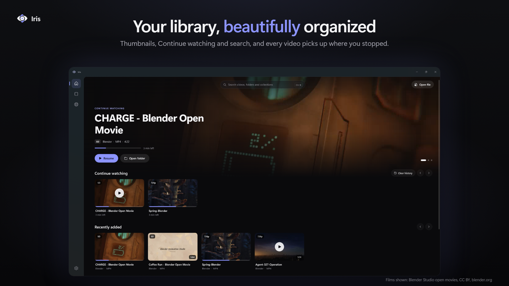
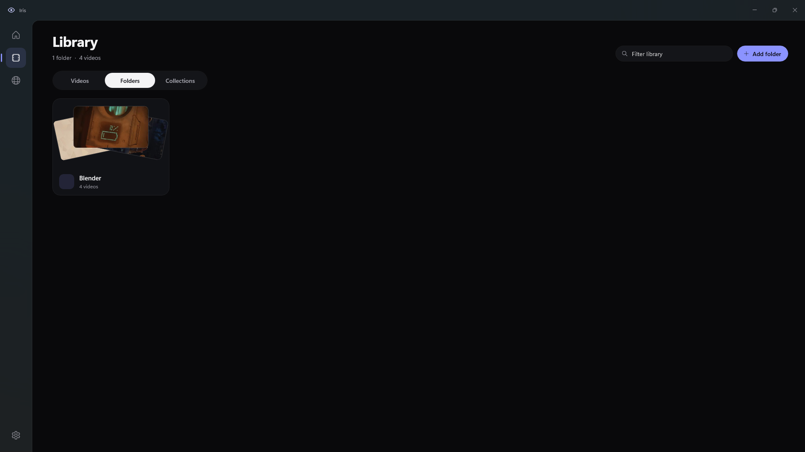
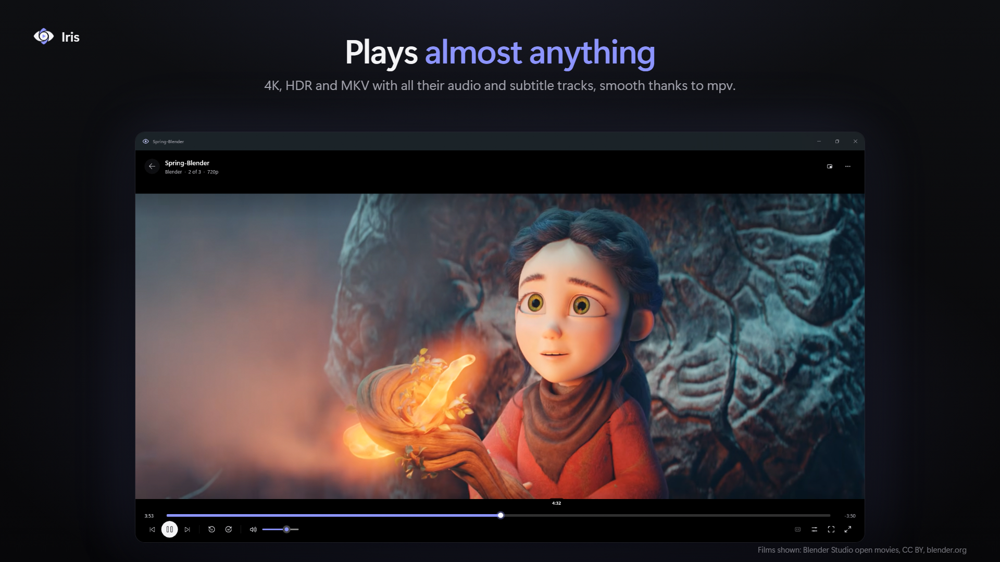
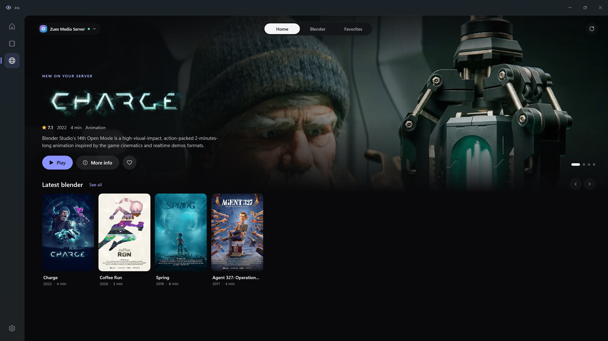

# Iris

A video player for Windows that I'm building for my own library.

You add your video folders, and Iris turns them into a library you can browse, search and pick
up where you left off. It plays pretty much anything, including 4K, HDR and MKV files with a
bunch of audio and subtitle tracks.

<table>
  <tr>
    <td width="50%" align="center">
      <a href="screenshots/home.png"></a><br>
      <sub><b>Home</b>: pick up where you left off, and see what's new</sub>
    </td>
    <td width="50%" align="center">
      <a href="screenshots/library.png"></a><br>
      <sub><b>Library</b>: your videos by video, folder or collection</sub>
    </td>
  </tr>
  <tr>
    <td width="50%" align="center">
      <a href="screenshots/player.png"></a><br>
      <sub><b>Player</b>: mpv doing the playback, with clean controls on top</sub>
    </td>
    <td width="50%" align="center">
      <a href="screenshots/server.png"></a><br>
      <sub><b>Jellyfin</b>: your server, browsed like a proper media center</sub>
    </td>
  </tr>
</table>

<sub>Films shown: <a href="https://studio.blender.org/films/">Blender Studio open movies</a> (Charge, Coffee Run, Spring, Agent 327), CC BY, blender.org.</sub>

## Why another media player?

I was using mpv for everything, with a bunch of random configs I picked up from here and there.
I also tried a few Jellyfin clients for my library. Not the best experience, to be honest.

So I thought, why not just make my own. Yes, yet another media player. This is my take on it:
mpv doing the playback, and a library and player on top that I actually enjoy using.

## Download

Grab the setup from [ryujininteractive](https://www.ryujininteractive.com/Iris-1/IrisMediaPlayer-win-Setup.exe)
and run it. It installs in a few seconds and opens Iris. No admin rights, nothing else to install.

Windows will probably show "Windows protected your PC" the first time. That's just because the
app isn't code-signed yet. Click **More info**, then **Run anyway**.

Iris updates itself. When I put out a new version, it downloads it in the background and asks
you to restart (or just installs it the next time you open it).

Runs on Windows 10 and 11, 64-bit.

## What it does right now

**Library**
- Add your folders and it finds all the videos inside, with thumbnails.
- Home shows what you were watching, what's new and what you played recently.
- Browse by video or by folder, filter by 4K, in progress or unwatched, and search everything.
- Make collections, basically your own playlists from any videos, wherever they are.
- Right-click a video to add it to a collection, open its folder, see its details or delete it.

**Watching**
- Plays almost any format smoothly, since [mpv](https://mpv.io) is doing the actual playback.
- Remembers where you stopped, and moves on to the next video in the folder.
- Switch audio and subtitle tracks, load your own subtitle files, and fix subtitles that are out of sync.
- Jump between chapters if the movie has them.
- Change speed, zoom (fit, fill or stretch), crop and aspect ratio.
- Mini player that stays on top while you do other stuff.
- Scroll over the video to change the volume.

**Media servers**
- Connect your **Jellyfin** server and browse it like a proper media center: films, shows,
  details pages, and picking the version, audio and subtitles before you play.
- Connect **Stash** too, with scenes, performers, studios, tags and markers.
- Your progress syncs back to the server, and you can switch between servers in one click.
- Plex is on the way.

**Opening files**
- Right-click a video in File Explorer and pick **Open with › Iris**, or just drag it onto Iris.
- If you want it as your default player, set it in **Settings › Apps › Default apps**.

## Keyboard shortcuts

| Key | What it does |
| --- | --- |
| Space | Play / pause |
| ← / → | Back / forward 5 seconds |
| J / L | Back / forward 10 seconds |
| ↑ / ↓ or mouse wheel | Volume |
| M | Mute |
| F | Fullscreen |
| V | Subtitles on / off |
| I | Mini player |
| Page Up / Page Down | Previous / next chapter |
| Shift+P / Shift+N | Previous / next video |
| C | Change zoom |
| Z / X | Subtitles earlier / later |
| Esc | Go back |
| Ctrl+K | Search the library |
| Ctrl+O | Open a video file |

## Other stuff

- Your library, collections and resume points are saved in `%LocalAppData%\Iris`.
- You can uninstall it from **Settings › Apps › Installed apps**. Your library stays, in case you
  come back.
- Next on my list: a preview picture when you hover the seek bar, and skip intro.

It's still a work in progress, so things will keep changing as I go.

---

## If you want to build it yourself

It's C#, .NET 8 and WinUI 3, with [mpv](https://mpv.io) for playback and
[Velopack](https://velopack.io) for installing and updating.

**Running it**

1. Install Visual Studio with the **WinUI application development** workload.
2. Open `Iris-MediaPlayer.slnx`, pick `x64` and hit **F5**.

**Making a release**

Releases are built by GitHub Actions from this repository ([release.yml](.github/workflows/release.yml)):
bump `<Version>` in `Iris-MediaPlayer/Iris-MediaPlayer.csproj`, push a matching tag such as `v1.3.1`,
and the workflow builds the installer and update packages into a draft GitHub release. You can also
build them locally with `build-installer.cmd`, which needs Visual Studio's MSBuild.

**What's where**

```text
Iris-MediaPlayer/          the app
.github/workflows/         the release build
installer/                 setup splash image
build-installer.cmd        builds the installer locally
LICENSE                    the GNU GPL v3 that Iris is released under
THIRD-PARTY-NOTICES.md     licences for the libraries Iris uses
```

## Licence

Iris is free software, released under the [GNU General Public License v3.0](LICENSE). You can use it,
change it and share it, including commercially, as long as anything you distribute that's built from
Iris is also released under the GPL with its source code. Copyright © 2026 Ryujin Interactive.

The libraries Iris uses keep their own licences; see [THIRD-PARTY-NOTICES.md](THIRD-PARTY-NOTICES.md).
